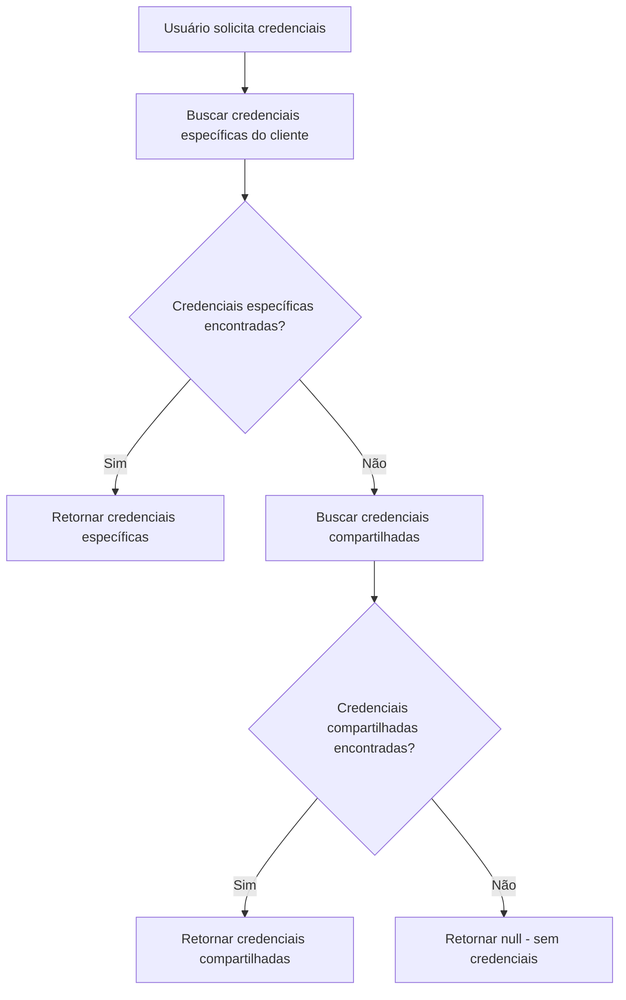

# 🔐 Solução para Credenciais Google Compartilhadas

## 📋 Problema Identificado

O sistema anterior tinha uma constraint `UNIQUE` no campo `cliente_id` da tabela `google_credentials`, o que impedia que múltiplos usuários utilizassem as mesmas credenciais do Google Cloud Console. Isso causava conflitos quando diferentes clientes tentavam usar as mesmas credenciais OAuth.

## 🎯 Solução Implementada

### 1. **Modificação do Schema do Banco**

**Arquivo:** `fix-google-credentials-shared.sql`

- ✅ Removida a constraint `UNIQUE` do campo `cliente_id`
- ✅ Adicionada constraint composta `UNIQUE (cliente_id, client_id, client_secret)`
- ✅ Criada view `shared_google_credentials` para monitorar uso
- ✅ Adicionados índices para melhor performance

### 2. **Novo Serviço de Credenciais Compartilhadas**

**Arquivo:** `src/lib/shared-google-credentials.ts`

**Funcionalidades:**
- 🔍 Busca credenciais específicas do cliente primeiro
- 🔄 Fallback para credenciais compartilhadas se não encontrar específicas
- 📊 Lista credenciais compartilhadas com estatísticas de uso
- ✅ Suporte a múltiplos clientes usando as mesmas credenciais

### 3. **Atualização dos Serviços Existentes**

**Arquivos atualizados:**
- `src/lib/google-calendar.ts`
- `src/lib/google-calendar-hybrid.ts`
- `src/contexts/GoogleCalendarContext.tsx`
- `src/contexts/GoogleCalendarContextSimple.tsx`

**Mudanças:**
- ✅ Substituição do `supabaseGoogleCredentialsService` por `sharedGoogleCredentialsService`
- ✅ Atualização de todas as referências para usar o novo serviço

## 🏗️ Como Funciona

### Fluxo de Busca de Credenciais



### Estrutura da Tabela Atualizada

```sql
CREATE TABLE google_credentials (
  id UUID PRIMARY KEY,
  cliente_id TEXT NOT NULL,
  client_id TEXT NOT NULL,
  client_secret TEXT NOT NULL,
  redirect_uri TEXT NOT NULL,
  calendar_id TEXT,
  configured BOOLEAN DEFAULT false,
  created_at TIMESTAMP,
  updated_at TIMESTAMP,
  
  -- Constraint que permite credenciais compartilhadas
  UNIQUE (cliente_id, client_id, client_secret)
);
```

### View de Monitoramento

```sql
CREATE VIEW shared_google_credentials AS
SELECT 
  client_id,
  client_secret,
  redirect_uri,
  calendar_id,
  COUNT(*) as usage_count,
  ARRAY_AGG(cliente_id) as clientes_using,
  MAX(created_at) as first_created,
  MAX(updated_at) as last_updated
FROM google_credentials 
WHERE configured = true
GROUP BY client_id, client_secret, redirect_uri, calendar_id;
```

## 🚀 Como Aplicar a Solução

### 1. **Execute o Script SQL**

```bash
# No SQL Editor do Supabase CRM
# Execute o arquivo: fix-google-credentials-shared.sql
```

### 2. **Verifique a Estrutura**

```sql
-- Verificar se a constraint foi removida
SELECT constraint_name, constraint_type 
FROM information_schema.table_constraints 
WHERE table_name = 'google_credentials';

-- Verificar a view
SELECT * FROM shared_google_credentials;
```

### 3. **Teste com Múltiplos Usuários**

```javascript
// Execute no console do navegador
// Arquivo: test-shared-credentials.js
```

## ✅ Benefícios da Solução

1. **🔓 Flexibilidade**: Múltiplos usuários podem usar as mesmas credenciais
2. **📊 Monitoramento**: View para acompanhar uso das credenciais
3. **🔄 Fallback Inteligente**: Busca específica primeiro, compartilhada depois
4. **⚡ Performance**: Índices otimizados para consultas
5. **🛡️ Segurança**: Mantém a integridade dos dados
6. **🔧 Compatibilidade**: Não quebra funcionalidades existentes

## 🧪 Testando a Solução

### Cenário de Teste

1. **Usuário A** configura credenciais Google
2. **Usuário B** tenta usar as mesmas credenciais
3. **Usuário C** também usa as mesmas credenciais
4. **Resultado**: Todos conseguem usar sem conflito

### Verificação

```sql
-- Deve retornar 3 registros com as mesmas credenciais
SELECT cliente_id, client_id, configured 
FROM google_credentials 
WHERE client_id = 'mesmo_client_id';

-- Deve mostrar usage_count = 3
SELECT * FROM shared_google_credentials;
```

## 📝 Próximos Passos

1. ✅ Execute o script SQL no Supabase
2. ✅ Teste com usuários reais na aplicação
3. ✅ Monitore a view `shared_google_credentials`
4. ✅ Documente quais credenciais são compartilhadas
5. ✅ Configure alertas se necessário

## 🔍 Monitoramento

Use a view `shared_google_credentials` para:
- Ver quantos clientes usam cada credencial
- Identificar credenciais mais utilizadas
- Monitorar mudanças nas credenciais
- Detectar possíveis problemas de uso

---

**✅ Solução implementada com sucesso!** 

Agora múltiplos usuários podem usar as mesmas credenciais do Google Cloud Console sem conflitos.


