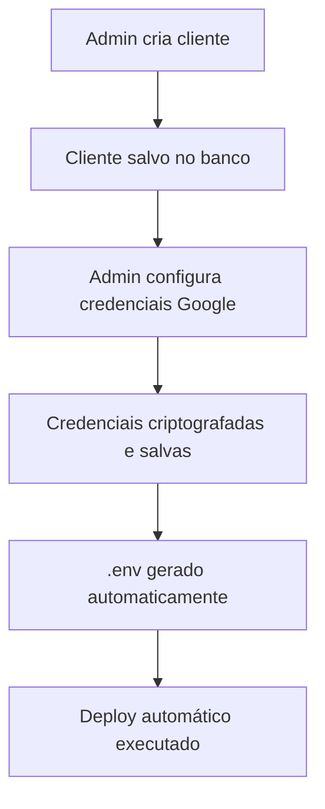
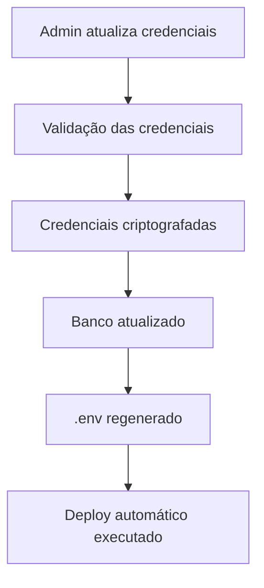

# 🔐 Solução Escalável para Credenciais Google

## 📋 Visão Geral

Esta solução implementa um sistema completo e escalável para gerenciar credenciais Google de forma segura para múltiplos clientes em um ambiente SaaS.

## 🎯 Problema Resolvido

- **Cada cliente** precisa de suas próprias credenciais Google Calendar
- **Credenciais devem ser secretas** e criptografadas
- **Sistema escalável** para centenas de clientes
- **Acesso restrito** apenas para super administradores
- **Deploy automático** de arquivos .env por cliente

## 🏗️ Arquitetura da Solução

### 1. **Armazenamento Seguro**
```typescript
// Tabela: google_credentials
{
  id: UUID,
  cliente_id: TEXT (único),
  client_id: TEXT (criptografado),
  client_secret: TEXT (criptografado),
  redirect_uri: TEXT,
  calendar_id: TEXT,
  configured: BOOLEAN,
  created_at: TIMESTAMP,
  updated_at: TIMESTAMP
}
```

### 2. **Criptografia AES-256**
- Todas as credenciais sensíveis são criptografadas
- Chave de criptografia configurável via .env
- Descriptografia automática quando necessário

### 3. **Geração Automática de .env**
- .env específico para cada cliente
- Inclui credenciais Google, configurações Supabase e app
- Salvo no Supabase Storage de forma segura

### 4. **Deploy Automático**
- Suporte a Vercel, Netlify, webhooks genéricos
- Deploy automático quando credenciais são atualizadas
- Configuração por cliente

## 📁 Estrutura de Arquivos

```
src/lib/
├── client-env-generator.ts          # Geração de .env por cliente
├── secure-credentials-manager.ts    # Gerenciamento seguro de credenciais
├── auto-deployment-service.ts       # Deploy automático
└── supabase-crm.ts                  # Conexão com Supabase CRM

src/components/
└── AdminCredentialsManager.tsx      # Interface administrativa

src/pages/
└── AdminDashboard.tsx               # Dashboard administrativo

sql/
├── create-deployment-configs-table.sql  # Tabela de configurações de deploy
└── setup-supabase-storage.sql           # Configuração do storage
```

## 🚀 Como Usar

### 1. **Configuração Inicial**

```bash
# 1. Execute os SQLs no Supabase
psql -f create-deployment-configs-table.sql
psql -f setup-supabase-storage.sql

# 2. Configure as variáveis de ambiente
VITE_ENCRYPTION_KEY=sua-chave-secreta-aqui
VITE_CRM_SUPABASE_URL=sua-url-supabase-crm
VITE_CRM_SUPABASE_ANON_KEY=sua-chave-anonima-crm
```

### 2. **Acesso Administrativo**

```typescript
// Login como super admin
const { adminSignIn } = useAdminAuth();
await adminSignIn('admin@kommuchat.com', 'admin123');

// Acesse: /admin/dashboard
```

### 3. **Gerenciar Credenciais**

```typescript
// Salvar credenciais para um cliente
await secureCredentialsManager.saveCredentials(
  'cliente-id',
  'google-client-id',
  'google-client-secret',
  'http://localhost:8080/auth/google/callback',
  'calendar-id',
  'admin@kommuchat.com'
);

// Gerar .env para o cliente
await clientEnvGenerator.updateClientEnv('cliente-id');
```

### 4. **Deploy Automático**

```typescript
// Configurar deploy automático
await autoDeploymentService.configureDeployment(
  'cliente-id',
  'https://api.vercel.com/v1/projects/...',
  'vercel-token',
  'production',
  true // auto deploy
);

// Deploy para todos os clientes
const results = await autoDeploymentService.deployToAllClients();
```

## 🔒 Segurança

### **Criptografia**
- AES-256 para credenciais sensíveis
- Chave de criptografia configurável
- Dados nunca armazenados em texto plano

### **Controle de Acesso**
- Apenas super admins podem gerenciar credenciais
- RLS (Row Level Security) no Supabase
- Logs de auditoria para todas as ações

### **Storage Seguro**
- Arquivos .env no Supabase Storage
- Acesso restrito por políticas RLS
- Limpeza automática de arquivos antigos

## 📊 Interface Administrativa

### **Dashboard Principal**
- Visão geral do sistema
- Estatísticas de clientes e credenciais
- Status de saúde do sistema

### **Gerenciamento de Credenciais**
- Lista todos os clientes
- Status das credenciais (configurado/não configurado)
- Criar/editar/remover credenciais
- Download de arquivos .env

### **Deploy Automático**
- Configurar deploy por cliente
- Testar configurações
- Executar deploy manual/automático

## 🔄 Fluxo de Trabalho

### **1. Criação de Cliente**


### **2. Atualização de Credenciais**


## 🛠️ Integrações Suportadas

### **Deploy Automático**
- ✅ Vercel
- ✅ Netlify
- ✅ Webhooks genéricos
- 🔄 Railway (em desenvolvimento)
- 🔄 AWS (em desenvolvimento)

### **Storage**
- ✅ Supabase Storage
- 🔄 AWS S3 (em desenvolvimento)
- 🔄 Google Cloud Storage (em desenvolvimento)

## 📈 Escalabilidade

### **Performance**
- Singleton pattern para serviços
- Cache de credenciais descriptografadas
- Operações assíncronas
- Índices otimizados no banco

### **Monitoramento**
- Logs detalhados de todas as operações
- Métricas de performance
- Alertas de erro
- Dashboard de status

## 🔧 Manutenção

### **Limpeza Automática**
```sql
-- Remove arquivos .env antigos (30+ dias)
SELECT cleanup_old_client_configs();
```

### **Backup de Segurança**
- Credenciais criptografadas no banco
- Arquivos .env no storage
- Logs de auditoria preservados

### **Atualizações**
- Sistema modular e extensível
- Versionamento de APIs
- Migração de dados automática

## 🚨 Troubleshooting

### **Problemas Comuns**

1. **Credenciais não descriptografam**
   - Verificar chave de criptografia
   - Verificar integridade dos dados

2. **Deploy falha**
   - Verificar configuração de deploy
   - Verificar tokens de autenticação
   - Verificar conectividade

3. **Storage não acessível**
   - Verificar políticas RLS
   - Verificar permissões do bucket
   - Verificar configuração do Supabase

### **Logs Úteis**
```typescript
// Habilitar logs detalhados
console.log('🔐 Salvando credenciais Google para cliente:', clienteId);
console.log('✅ Credenciais Google salvas com sucesso');
console.log('🚀 Iniciando deploy automático para cliente:', clienteId);
```

## 📞 Suporte

Para dúvidas ou problemas:
1. Verifique os logs do console
2. Consulte a documentação do Supabase
3. Verifique as configurações de ambiente
4. Teste as credenciais Google manualmente

---

**Desenvolvido para KOMMUchat CRM**  
*Sistema de gerenciamento de credenciais Google escalável e seguro*
